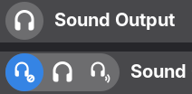

# GNOME Noise Control Mode Switcher

Show and switch a Bluetooth headset's noise-control mode — normal, noise
cancelling, or ambient sound — on Linux, without the vendor's app, without root
and without re-pairing. It talks to the headset over the Bluetooth connection
that is already up.

Two front-ends share one set of protocol implementations:

- a **GNOME Shell extension** that puts the modes into Quick Settings;
- **`scripts/*.py`** a CLI for scripts and keybindings.

**Supported devices:**
- Sony WH-1000XM5: proprietary RFCOMM protocol, "v2" variant (extension + `scripts/xm5.py`);
- Samsung Galaxy Buds FE (and, untested, Buds Pro / 2 / 2 Pro): Samsung SPP
  protocol as documented by GalaxyBudsClient (extension + `scripts/buds.py`).



## GNOME Shell extension

The headset icon in the **Sound Output** header (Quick Settings → volume slider
→ `>`) becomes a clickable "pill":

- Collapsed, it is a single circle showing the current mode's icon.
- Click it and it grows into a row of three icons: the current mode plus the two
  others.
- Click another mode and the headset switches; the pill collapses back to a
  circle showing the new mode. Clicking the current mode just collapses.

It is active only while a supported headset is connected. On disconnect (or when
the extension is disabled) the stock headphones icon is restored.

### Requirements

- GNOME Shell 50 (Wayland or X11), tested on 50.4.
- A supported headset paired and connected over Bluetooth.
- No root, no Python; the extension uses GJS + BlueZ only.

### Install

```
ln -s "$PWD" ~/.local/share/gnome-shell/extensions/anc-mode@snizovtsev.github.io
```

Then log out and back in (Wayland cannot reload the live shell), and:

```
gnome-extensions enable anc-mode@snizovtsev.github.io
```

## CLI

```
scripts/xm5.py                 # show current mode
scripts/xm5.py set nc          # noise cancelling
scripts/xm5.py set ambient --level 12 --voice
scripts/xm5.py set off         # normal
scripts/xm5.py toggle          # off -> nc -> ambient -> off  (bind this to a key)
scripts/xm5.py --json          # {"mode": "nc", "focus_on_voice": false, "ambient_level": 20, ...}
scripts/xm5.py -v get          # dump raw frames
```

Galaxy Buds use the same commands with `scripts/buds.py`; the extras differ:

```
scripts/buds.py set ambient --level 2       # ambient volume 0..2
scripts/buds.py set nc --anc-level high     # ANC strength low|high: the FE firmware
                                            # accepts and reports it, but Samsung's app
                                            # hides it on this model, so the effect is unverified
scripts/buds.py --json   # {"mode": "off", "ambient_level": 1, "anc_level": "low", "battery_left": 94, ...}
```

Dependencies: python3, dbus-python, PyGObject (Arch: `python-dbus python-gobject`).

Each invocation takes roughly a second: connect, init handshake, GET, optional
SET, disconnect. The headset keeps A2DP/HFP running throughout.

## Layout

Extension sources live at the repository root, as
extensions.gnome.org requires.

| Path | What it is |
| --- | --- |
| `session.js` | The device-independent part: the three `MODES`, and `StreamSession`, the base class every driver extends. Its doc comment is the contract (`open()`, `setMode()`, `mode`, `state`, `mode-changed`, `closed`) the backend and UI rely on. |
| `sony.js` | `SonySession`: Sony frame encode/decode, sequence/ACK handling, ambient-sound-control GET/SET/NOTIFY. A port of `scripts/xm5.py`. |
| `samsung.js` | `BudsSession`: Samsung SPP framing with CRC-16, extended status, NOISE_CONTROLS set and its ACK / update replies. A port of `scripts/buds.py`. |
| `devices.js` | The driver list. Each driver is `{id, match({name, uuids}) -> service UUID, Session}`; adding a headset means one new module and one line here. |
| `bluez.js` | `HeadsetBackend`: watches BlueZ for a connected device some driver claims, opens its RFCOMM control service, keeps one session alive, emits `state-changed` / `mode-changed`. Knows nothing vendor-specific. |
| `headerPill.js` | `AncPill` (the widget) and `HeaderPillInstaller` (swaps it into the Sound Output header, restores the stock icon). |
| `indicator.js` | Optional top-bar button with a radio menu. Off by default; set `SHOW_INDICATOR = true` in `extension.js`. Useful when the volume slider has no device menu (only one output device present). |
| `extension.js` | Entry point. |
| `scripts/xm5.py` | The Sony CLI. |
| `scripts/buds.py` | The Galaxy Buds CLI. |
| `dev/` | Development helpers, not shipped. |

BlueZ resolves the RFCOMM channel from the control service UUID each driver
advertises (Sony `956c7b26-d49a-4ba8-b03f-b17d393cb6e2`, Samsung
`2e73a4ad-332d-41fc-90e2-16bef06523f2`) through the `org.bluez.Profile1` D-Bus
API and hands over a socket fd, so no `sdptool` is needed. The CLIs' `-c N`
connects to RFCOMM channel N directly using the stdlib only (untested fallback).

Because the extension holds the RFCOMM control link open, it follows mode
changes made with the buttons on the headset itself. Only one program can hold
that link at a time, so the CLIs cannot connect while the extension is enabled,
and vice versa.

## Development

`dev/run-headless.sh` starts a throwaway nested GNOME Shell (in-memory settings,
so nothing touches your real session) with only this extension enabled, and
`dev/drive.py` screenshots and clicks it over the nested session bus. Setting
`ANC_TEST_OPEN=1` makes the extension auto-open the Sound Output menu so the
pill is easy to screenshot.

```
ANC_TEST_OPEN=1 dev/run-headless.sh /tmp/anc-bus &
dev/drive.py -a /tmp/anc-bus shot /tmp/shot.png
```

## Protocol notes

### Sony

As observed on one WH-1000XM5 (firmware reported by the init reply
`01 00 03 00 20 16 00 00`):

```
frame    = 3E  escape(type seq len:4BE payload chk)  3C
escape   = 3E/3C/3D -> 3D (b & EF);  chk = sum(type..payload) & FF
types    = ACK 01, COMMAND_1 0C;  every COMMAND is ACKed with seq' = 1 - seq
init     : 0C [00 00]  ->  ACK, 0C [01 ...]
get mode : 0C [66 17]  ->  ACK, 0C [67 17 01 on amb voice level]
set mode : 0C [68 17 01 on amb voice level]  ->  ACK, 0C [69 17 ...] (notify)
    on=00 -> normal; on=01,amb=00 -> noise cancelling; on=01,amb=01 -> ambient
    voice = focus-on-voice (00/01), level = ambient level 1..20
```

Sources: Gadgetbridge `service/devices/sony/headphones/` (SonyProtocolImplV2,
Message.java, PayloadTypeV1), https://github.com/Freeyourgadget/Gadgetbridge

### Samsung

As observed on Galaxy Buds FE (extended status revision 3):

```
frame    = FD  hdr:2LE  id  payload  crc16:2LE  DD
hdr      = size | flags; size = len(payload) + 3, flag 1000 = device -> host
crc16    = CRC-16/XMODEM over id + payload
on connect : 61 [rev .. battL battR .. mode@12 .. ambVol@23 ancLevel@24 ..]   (pushed)
set mode   : 78 [mode]  ->  42 [78 mode]   (ACK; only when something changed)
             re-selecting the current mode gets 61 + 77 [mode ..] instead
button     : 77 [mode wear..]  pushed by the buds
ambient vol: 84 [0..2]  ->  42 [84 vol];  anc level: 83 [0|1]  ->  42 [83 lvl]
    mode 00 normal, 01 noise cancelling, 02 ambient, 03 adaptive
```

Sources: GalaxyBudsClient `GalaxyBudsClient/Message/` (SppMessage,
SppMessageEnums, Decoder/ExtendedStatusUpdateDecoder) and
`Model/Constants.cs`, https://github.com/ThePBone/GalaxyBudsClient

## License

GPL-2.0-or-later — the license GNOME Shell itself uses and the one
extensions.gnome.org requires. See `LICENSE`.

The wire protocols above were documented by the Gadgetbridge project
(AGPL-3.0-or-later) and by GalaxyBudsClient (GPL-3.0); the code here is an
independent implementation written from that documentation, not a translation of
their sources.
